<p align="center">
  
</p>

<h1 align="center">Sodeom — Private Search Engine</h1>

<p align="center">
  <strong>Private search with zero tracking and minimal filtering.</strong><br/>
  Self-hostable · SearXNG-powered · JSON API · Keyless MCP server for AI agents
</p>

<p align="center">
  <a href="https://sodeom.com/"></a>
  <a href="https://sodeom.com/apis"></a>
  <a href="https://sodeom.com/apis/mcp"></a>
</p>

<p align="center">
  
  
  
  
  
</p>

---

## Table of Contents

- [What is Sodeom?](#what-is-sodeom)
- [Live Demo](#live-demo)
- [Screenshots](#screenshots)
- [Features](#features)
- [Privacy & Security](#privacy--security)
- [Architecture](#architecture)
- [Tech Stack](#tech-stack)
- [Getting Started](#getting-started)
  - [Prerequisites](#prerequisites)
  - [Installation](#installation)
  - [Running](#running)
  - [Verify it works](#verify-it-works)
- [Using Sodeom](#using-sodeom)
- [API Reference](#api-reference)
  - [Web Search](#web-search-api)
  - [Wiki Lookup](#wiki-lookup-api)
  - [Images / Videos / News pages](#images--videos--news)
  - [Placeholder Image](#placeholder-image-api)
  - [OpenAI-compatible API](#openai-compatible-api)
  - [Agent endpoint](#agent-endpoint)
  - [MCP Server for AI Agents](#mcp-server-for-ai-agents)
- [Routes Overview](#routes-overview)
- [Project Structure](#project-structure)
- [How Search Works](#how-search-works)
- [Configuration](#configuration)
- [Testing](#testing)
- [Self-Hosting & Deployment](#self-hosting--deployment)
- [Contributing](#contributing)
- [License](#license)
- [Contact](#contact)

---

## What is Sodeom?

**Sodeom** is a privacy-first, open-source search engine built with Python and Flask. It aggregates results through **SearXNG** — which fans out to Brave, Bing, DuckDuckGo, Wikipedia, Wikidata, YouTube and more — while acting as a proxy between you and those services. **They never see your IP, cookies, or identity.** Only the Sodeom server talks to upstream providers, either directly or through an optional Cloudflare Worker relay.

Founded in 2025 by **Abdul Hadi**, Sodeom is built for people who want fast, relevant results without being the product.

> _"Search should be private by default."_

Beyond the web UI, the same instance exposes a **JSON search API**, an **OpenAI-compatible `/v1` endpoint**, and a **public keyless MCP server** so AI agents can search the web through it.

---

## Live Demo

| | |
| --- | --- |
| 🌐 **Search** | <https://sodeom.com/> |
| 🖼️ **Images** | <https://sodeom.com/images?q=mountain> |
| 📰 **News** | <https://sodeom.com/news?q=artificial+intelligence> |
| 🎬 **Videos** | <https://sodeom.com/videos?q=flask> |
| 🔌 **API docs** | <https://sodeom.com/apis> |
| 🤖 **MCP** | <https://sodeom.com/mcp> · [docs](https://sodeom.com/apis/mcp) |
| 📜 **Privacy policy** | <https://sodeom.com/privacy-policy> |

---

## Screenshots

<p align="center">
  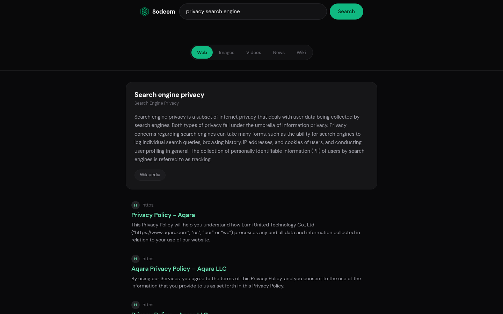
  <br/><em>Web search — instant answers, Wikipedia infobox and aggregated results.</em>
</p>

<p align="center">
  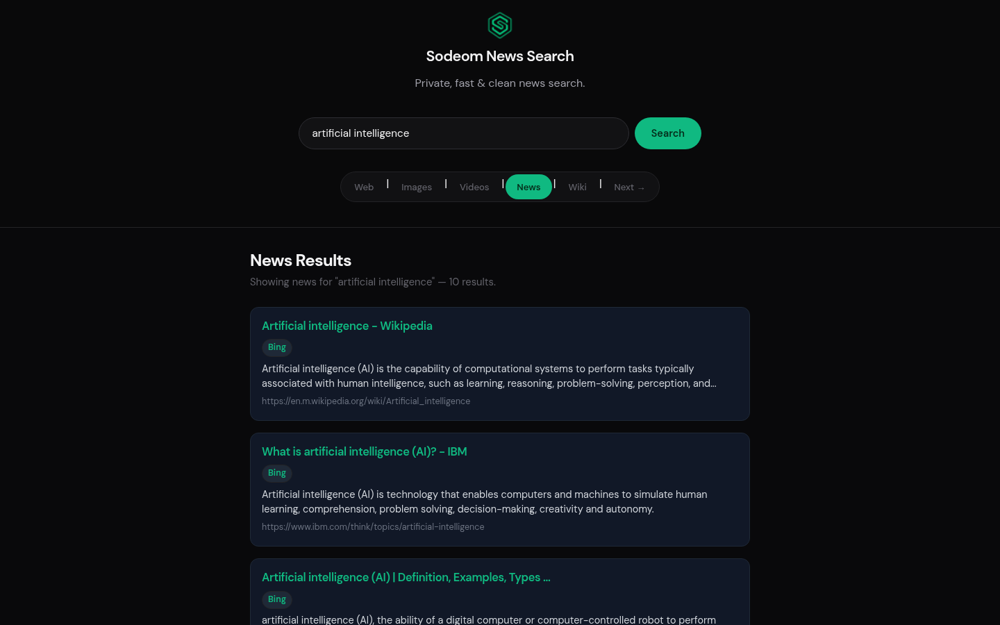
  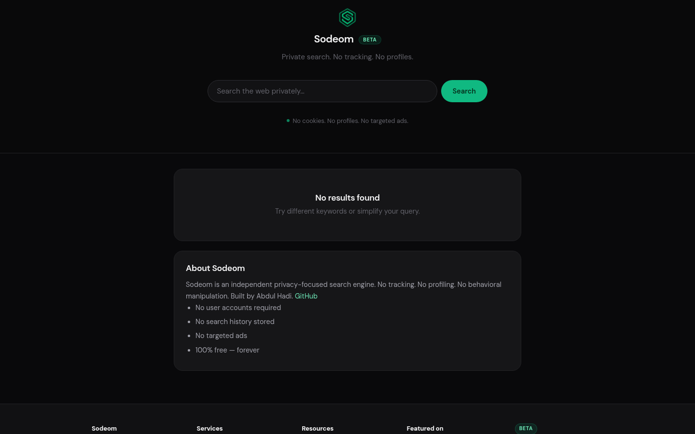
  <br/><em>News search and the homepage — no cookies, no profiles, no targeted ads.</em>
</p>

<p align="center">
  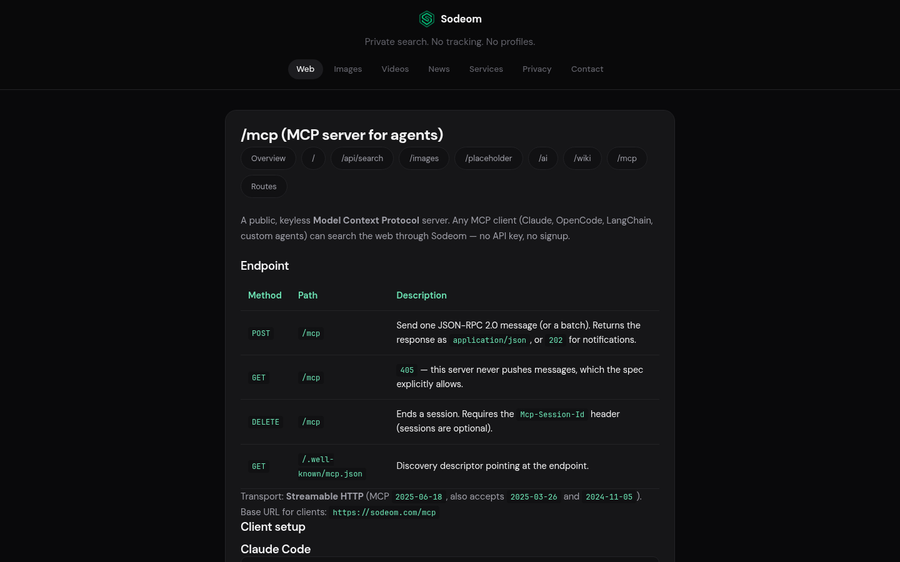
  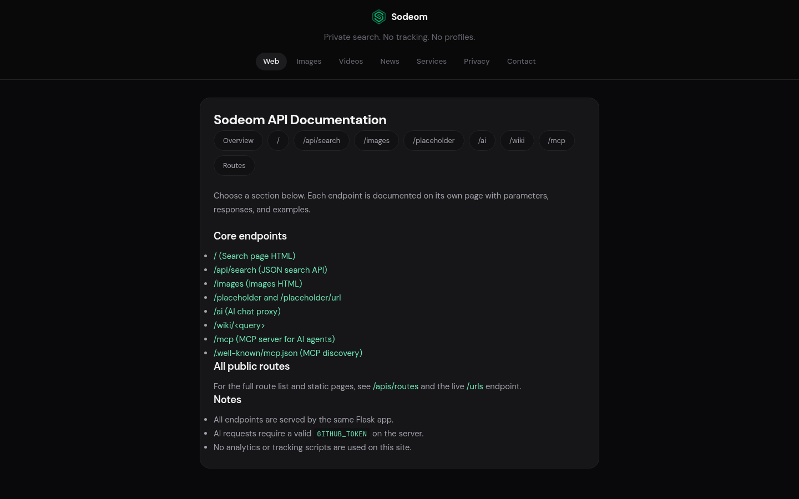
  <br/><em>Built-in documentation for the MCP server and the REST API.</em>
</p>

---

## Features

| Feature | Description |
| --- | --- |
| **Private by Design** | Zero logging, no tracking cookies, no analytics, no user profiles |
| **Multi-Engine Aggregation** | SearXNG fans out to Brave, Bing, DuckDuckGo, Wikipedia, Wikidata and more |
| **Web Search** | Paginated results with spell corrections, suggestions, infoboxes and instant answers |
| **Images / Videos / News** | Dedicated verticals with per-engine result normalisation |
| **Adult Content Filtering** | Keyword blocklist applied to every vertical, `safesearch=1` by default |
| **Search API** | JSON REST API with `general`, `images`, `videos` and `news` categories |
| **OpenAI-compatible API** | Point any OpenAI SDK at `/v1` — chat completions, streaming, tools |
| **Agent Endpoint** | `/ai/agent` runs a tool-call loop with built-in web/wiki/news tools |
| **Keyless MCP Server** | `/mcp` speaks JSON-RPC 2.0 so AI agents can search without a key |
| **Placeholder Image API** | Fetch and serve images by keyword — handy for prototypes and mockups |
| **In-memory Result Cache** | 10-minute TTL, 300 entries, thread-safe; empty responses cached for 60s |
| **Self-Hostable** | Runs locally, on a VPS, in Docker, or on PythonAnywhere |
| **Security Headers** | DNT, no-referrer, FLoC blocking, CSP, HSTS, X-Frame-Options on every response |
| **Open Source** | GPLv3 — fully auditable and transparent |

---

## Privacy & Security

Sodeom takes a **zero-knowledge** approach to search:

### What Sodeom Does NOT Do

- ❌ Log or store your search queries
- ❌ Use analytics or tracking cookies
- ❌ Track your IP address
- ❌ Build user profiles
- ❌ Share data with third parties
- ❌ Use browser fingerprinting or session tracking
- ❌ Leak referrer information to external sites

### How Your Privacy is Protected

| Protection | Implementation |
| --- | --- |
| **Proxy Model** | Search engines see the Sodeom server IP, never yours |
| **No Logging** | Search queries are not persisted server-side |
| **No Cookies** | No tracking cookies are set |
| **Referrer Policy** | `Referrer-Policy: no-referrer` on all responses |
| **FLoC/Topics Blocked** | `Permissions-Policy: interest-cohort=()` header |
| **Content Security Policy** | Locked to `'self'` plus Google Fonts and video embeds |
| **Security Headers** | `X-Content-Type-Options: nosniff`, `X-Frame-Options: SAMEORIGIN`, `DNT: 1`, HSTS |
| **Cache Control** | `no-store, no-cache, must-revalidate, private` — HTML responses are never cached |
| **SSRF Guard** | MCP `fetch_url` refuses private, loopback and link-local addresses |

Headers are attached by `core/middleware.py:add_privacy_headers()` via Flask's `after_request`. Static assets are the only thing served with a long-lived cache.

---

## Architecture

### Request flow

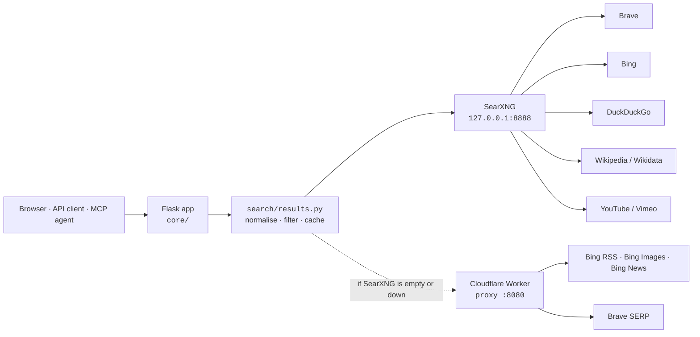

The browser only ever talks to Sodeom. Everything upstream — SearXNG, the Cloudflare Worker relay and the engines behind it — is invisible to the client.

### Module map

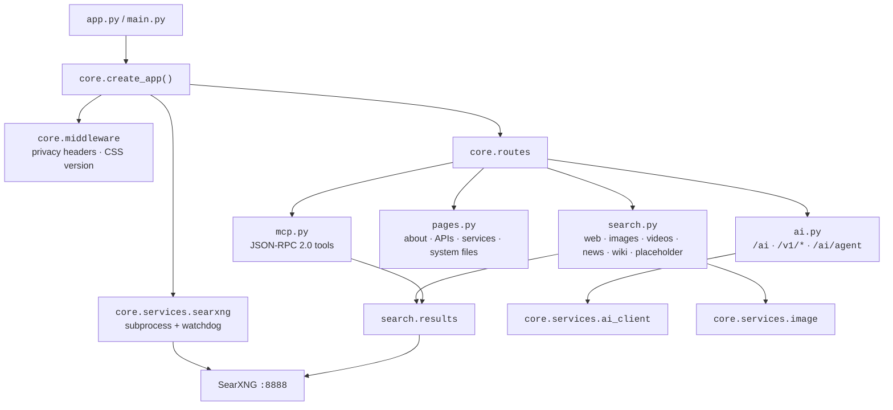

### Search pipeline

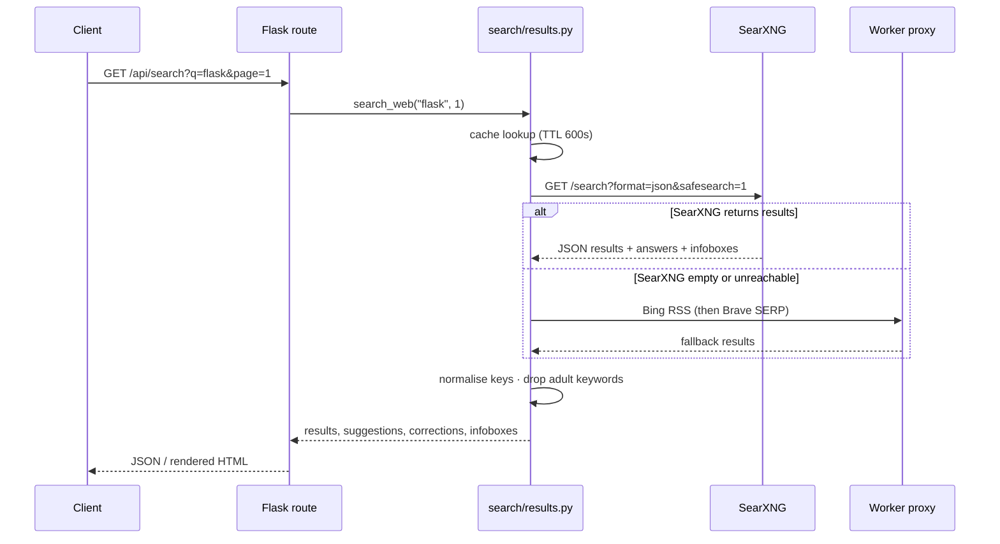

### Deployment topology

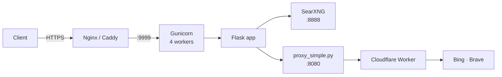

---

## Tech Stack

| Layer | Choice |
| --- | --- |
| Web framework | Flask (application factory + blueprints) |
| Search aggregation | SearXNG (vendored in `searxng_src/`) |
| HTTP client | `requests` (pooled session), `httpx` |
| Parsing | `selectolax`, `beautifulsoup4`, regex scrapers |
| AI client | `openai` SDK pointed at Mistral / GitHub Models / Ollama / OpenCode |
| Persistence | SQLite (`db/userdb.py`, optional AI counters) |
| Frontend | Jinja2 templates + hand-written CSS, no build step |
| Runtime | Python 3.10+, Gunicorn in production |

---

## Getting Started

### Prerequisites

- **Python 3.10+**
- **pip**
- ~2 GB of disk for the vendored SearXNG dependencies
- Linux/macOS recommended (SearXNG is launched as a subprocess)

### Installation

1. **Clone the repository**

   ```bash
   git clone https://github.com/sodeom/sodeom.git
   cd sodeom
   ```

2. **Create a virtualenv and install dependencies**

   ```bash
   python3 -m venv .venv
   .venv/bin/pip install -r requirements.txt
   ```

   `requirements.txt` recursively includes `searxng_src/requirements.txt`, so the first install is heavy. This is expected — SearXNG runs from the same environment.

3. **Configure the environment** (optional for local use)

   ```bash
   cp .env.example .env
   ```

   A `.env` is loaded automatically by `core/__init__.py` before any local module is imported. At minimum, set a secret key in production:

   ```env
   FLASK_SECRET_KEY=change-me-to-a-random-string
   ```

   See [Configuration](#configuration) for the full list.

### Running

The quickest path — creates the venv, installs requirements and starts the server:

```bash
bash start.sh
```

Or manually:

```bash
.venv/bin/python app.py
```

The server listens on **`http://0.0.0.0:9999`**. SearXNG is started in a background thread on `127.0.0.1:8888` (using `searxng_src/settings_local.yml`) along with the Cloudflare Worker relay on `127.0.0.1:8080`.

Open <http://localhost:9999> to start searching.

> **First boot is slow.** SearXNG can take up to a minute to become ready. Watch `/tmp/searxng.log` and `/tmp/proxy.log`. A watchdog thread restarts SearXNG if port 8888 dies.

### Verify it works

```bash
curl "http://localhost:9999/api/search?q=flask" | head -c 300
```

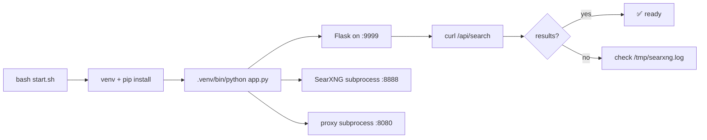

---

## Using Sodeom

### In the browser

1. Open the homepage and type a query.
2. Switch between **Web · Images · Videos · News · Wiki** using the tabs under the search bar.
3. Results link directly to the source; Sodeom never wraps or redirects them.

<p align="center">
  
</p>

### From the command line

```bash
# Web results as JSON
curl "https://sodeom.com/api/search?q=python+flask"

# News
curl "https://sodeom.com/api/search?q=ai&category=news"

# Wikipedia summary
curl "https://sodeom.com/api/wiki?q=Alan+Turing"

# Grab a placeholder image and save it
curl -L "https://sodeom.com/placeholder?q=mountain" -o mountain.jpg
```

### From Python

```python
import requests

r = requests.get("https://sodeom.com/api/search", params={"q": "flask sse"}, timeout=15)
for item in r.json()["results"][:5]:
    print(item["title"], "→", item["link"])
```

### From an AI agent

Point any MCP client at `https://sodeom.com/mcp` — no key, no signup. Details in [MCP Server for AI Agents](#mcp-server-for-ai-agents).

---

## API Reference

All endpoints are read-only and require **no API key**.

### Web Search API

**Endpoint:** `GET /api/search`

| Parameter | Type | Required | Description |
| --- | --- | --- | --- |
| `q` | string | Yes | Search query |
| `page` | int | No | Page number (default `1`) |
| `category` | string | No | `general` (default), `images`, `videos`, `news` |

**Example request:**

```bash
curl "https://sodeom.com/api/search?q=python+flask&page=1"
```

**Example response:**

```json
{
  "results": [
    {
      "title": "Welcome to Flask — Flask Documentation (3.1.x)",
      "link": "https://flask.palletsprojects.com/",
      "description": "Flask is a lightweight WSGI web application framework...",
      "pretty_url": "https://flask.palletsprojects.com/",
      "engine": "bing",
      "category": "general",
      "score": 0,
      "thumbnail": "",
      "img_src": ""
    }
  ],
  "query": "python flask",
  "page": 1,
  "category": "general",
  "has_next": true,
  "has_prev": false,
  "total_results": 10,
  "suggestions": [],
  "corrections": [],
  "infoboxes": [],
  "answers": []
}
```

Missing `q` returns `400 {"error": "Missing query parameter 'q'"}`; upstream failures return `500 {"error": "Search temporarily unavailable"}`.

---

### Wiki Lookup API

**Endpoint:** `GET /api/wiki?q=<topic>`

Returns Wikipedia infobox data plus a short extract. Disambiguation pages fall back to full-text search.

```json
{
  "infoboxes": [
    {
      "infobox": "Alan Turing",
      "id": "https://en.wikipedia.org/wiki/Alan_Turing",
      "content": "Alan Mathison Turing was an English mathematician...",
      "img_src": "https://upload.wikimedia.org/...",
      "urls": [{ "title": "Wikipedia", "url": "https://en.wikipedia.org/wiki/Alan_Turing" }]
    }
  ],
  "answers": []
}
```

The HTML equivalent is `GET /wiki/<query>`.

---

### Images / Videos / News

These render HTML pages (not JSON) but share the same backend as the API categories.

| Endpoint | Description |
| --- | --- |
| `GET /images?q=&page=` | Image grid with source and resolution |
| `GET /videos?q=&page=` | Video results (mostly YouTube) |
| `GET /news?q=&page=` | Recent articles with source and publish date |

<p align="center">
  
</p>

---

### Placeholder Image API

Fetch an image by keyword — useful for prototyping, mockups and development.

**Endpoint:** `GET /placeholder`

| Parameter | Type | Required | Description |
| --- | --- | --- | --- |
| `q` | string | Yes | Image keyword (e.g. `cat`, `sunset`) |
| `page` | int | No | Page for different results (default `1`) |

**Use in HTML:**

```html

```

**Get the image URL only:**

```bash
curl "https://sodeom.com/placeholder/url?q=mountain"
```

Returns the direct image URL as plain text. If nothing safe is found, the bundled `static/not-found.png` is served.

---

### OpenAI-compatible API

Sodeom exposes an OpenAI-shaped API so any SDK or framework can use it:

```python
from openai import OpenAI

client = OpenAI(base_url="https://sodeom.com/v1", api_key="unused")

resp = client.chat.completions.create(
    model="beam",
    messages=[{"role": "user", "content": "Explain SearXNG in one sentence."}],
)
print(resp.choices[0].message.content)
```

| Endpoint | Method | Notes |
| --- | --- | --- |
| `/v1/models` | GET | Lists the models this deployment serves |
| `/v1/models/<id>` | GET | Unknown IDs alias to the configured default |
| `/v1/chat/completions` | POST | Streaming (`stream: true`), tools, `stream_options.include_usage` |
| `/v1/completions` | POST | Legacy text completions for older SDKs |
| `/v1/embeddings` | POST | Returns `501` — this deployment serves chat models only |
| `/ai` | GET, POST | Simple `{ "answer": "..." }` helper |
| `/ai/agent` | POST | Tool-calling loop (see below) |

Robustness notes:

- Extra params the upstream rejects (`response_format`, `seed`, …) trigger one retry with only core params.
- Reasoning models that burn a small `max_tokens` budget on reasoning are retried with a larger one.
- `stream_options` is handled locally and never forwarded upstream.

---

### Agent Endpoint

**Endpoint:** `POST /ai/agent`

Runs a bounded tool-call loop with built-in `web_search`, `wiki_lookup`, `news_search` and `run_python` tools.

```bash
curl -s https://sodeom.com/ai/agent \
  -H "Content-Type: application/json" \
  -d '{"query": "What is the latest Python release?", "max_steps": 5}'
```

```json
{ "answer": "...", "messages": [...], "steps": 2 }
```

`max_steps` is capped at 10. `run_python` executes in a subprocess with a 10-second timeout and truncated output.

---

### MCP Server for AI Agents

Sodeom exposes a **public, keyless [Model Context Protocol](https://modelcontextprotocol.io) server** at **<https://sodeom.com/mcp>** (Streamable HTTP transport). Claude Code, Claude Desktop, OpenCode, LangChain MCP adapters or your own bot can search the web through Sodeom with **zero API keys and zero signup**.

Full docs: <https://sodeom.com/apis/mcp> · discovery: <https://sodeom.com/.well-known/mcp.json>

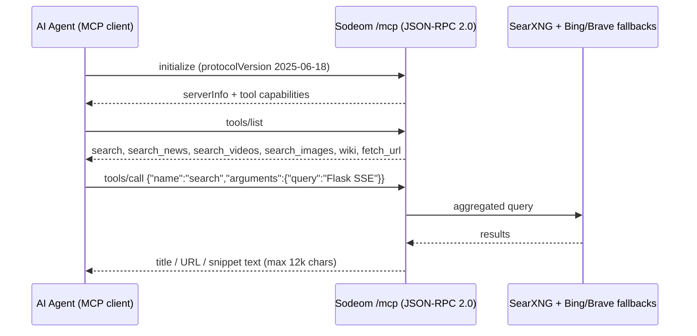

#### Quick start

```bash
# Claude Code
claude mcp add --transport http sodeom https://sodeom.com/mcp

# Any stdio client
npx -y mcp-remote https://sodeom.com/mcp

# Raw JSON-RPC over HTTP
curl -s https://sodeom.com/mcp \
  -H "Content-Type: application/json" \
  -d '{"jsonrpc":"2.0","id":1,"method":"tools/call",
       "params":{"name":"search","arguments":{"query":"python 3.14"}}}'
```

OpenCode (`~/.config/opencode/opencode.json`):

```json
{
  "mcp": {
    "servers": {
      "sodeom": { "type": "remote", "url": "https://sodeom.com/mcp" }
    }
  }
}
```

#### Tools

| Tool | Arguments | What it does |
| --- | --- | --- |
| `search` | `query`, `page`, `language` | Web search (title / URL / snippet lines) |
| `search_news` | `query`, `page`, `language` | Recent news articles |
| `search_videos` | `query`, `page`, `language` | Video results (mostly YouTube) |
| `search_images` | `query`, `page`, `language` | Images with direct `img_src` URLs |
| `wiki` | `query`, `language` | Wikipedia / Wikidata facts and links |
| `fetch_url` | `url`, `max_chars` | Reads a public page as text (8k chars, SSRF-guarded) |

#### Live example

```python
from mcp import ClientSession
from mcp.client.streamable_http import streamable_http_client  # mcp>=2

# on the 1.x SDK: from mcp.client.streamable_http import streamablehttp_client
# and unpack as (read, write, _)

async with streamable_http_client("https://sodeom.com/mcp") as (read, write):
    async with ClientSession(read, write) as session:
        await session.initialize()
        result = await session.call_tool("search", {"query": "Flask SSE streaming"})
        print(result.content[0].text)
```

Notes:

- **No auth, no rate-limit key** — the endpoint is read-only and public by design.
- `Mcp-Session-Id` is issued on `initialize` but never required (stateless clients work).
- Tool output is plain text capped at 12 000 characters to protect agent context windows.
- `fetch_url` refuses private / loopback / link-local addresses, including after redirects.
- Protocol: `2025-06-18` (also accepts `2025-03-26` and `2024-11-05`).
- `GET /mcp` answers `405` — the server has no server-push channel, which the spec allows.

---

## Routes Overview

| Route | Method | Description |
| --- | --- | --- |
| `/` | GET | Homepage & web search |
| `/api/search` | GET | JSON search API (`general`/`images`/`videos`/`news`) |
| `/api/wiki` | GET | Wikipedia infobox JSON |
| `/wiki/<query>` | GET | Wiki lookup page |
| `/images` | GET | Image search |
| `/videos` | GET | Video search |
| `/news` | GET | News search |
| `/placeholder` | GET | Placeholder image (serves file) |
| `/placeholder/url` | GET | Placeholder image URL (plain text) |
| `/ai` | GET, POST | Simple AI answer helper |
| `/ai/agent` | POST | Tool-calling agent loop |
| `/v1/models` | GET | OpenAI-compatible model list |
| `/v1/models/<id>` | GET | OpenAI-compatible model info |
| `/v1/chat/completions` | POST | OpenAI-compatible chat (streaming supported) |
| `/v1/completions` | POST | OpenAI-compatible legacy completions |
| `/v1/embeddings` | POST | `501` by design |
| `/mcp` | POST, DELETE, OPTIONS | **MCP server for AI agents (no API key)** |
| `/.well-known/mcp.json` | GET | MCP discovery descriptor |
| `/about` | GET | About page |
| `/contact` | GET | Contact page |
| `/faq` | GET | Frequently asked questions |
| `/privacy-policy` | GET | Privacy policy |
| `/terms` | GET | Terms of service |
| `/services` | GET | Services overview |
| `/services/ai` · `/software` · `/sodium` · `/webs` · `/projects` · `/trillioniar` | GET | Service detail pages |
| `/apis` | GET | API documentation |
| `/apis/search` · `/images` · `/placeholder` · `/wiki` · `/ai` · `/mcp` · `/root` · `/routes` | GET | Per-endpoint docs |
| `/urls` | GET | All available routes |
| `/blog/<blog>` | GET | Blog posts |
| `/funprojects` | GET | Fun projects page |
| `/fake-sha256` | GET | SHA-256 tool |
| `/metrics` | GET | Metrics placeholder |
| `/robots.txt` · `/sitemap.xml` · `/ads.txt` · `/favicon.ico` | GET | System files |

---

## Project Structure

```
sodeom/
├── app.py                     # Entry point: from core import create_app
├── main.py                    # Equivalent entry point
├── core/
│   ├── __init__.py            # create_app(): env, headers, blueprints, SearXNG boot
│   ├── middleware.py          # Privacy/security headers, CSS cache-busting hash
│   ├── routes/
│   │   ├── __init__.py        # register_blueprints()
│   │   ├── search.py          # /, /api/search, /images, /videos, /news, /wiki, /placeholder
│   │   ├── ai.py              # /ai, /ai/agent, /v1/* OpenAI-compatible endpoints
│   │   ├── pages.py           # Informational pages, API docs, robots/sitemap
│   │   └── mcp.py             # JSON-RPC 2.0 MCP server + discovery
│   ├── services/
│   │   ├── searxng.py         # SearXNG subprocess lifecycle + watchdog
│   │   ├── image.py           # Placeholder image install/cache
│   │   └── ai_client.py       # OpenAI client, model routing, error helper
│   └── utils/
│       ├── encoding.py        # Query encoding helpers
│       └── proxy.py           # Proxy helpers
├── search/
│   └── results.py             # SearXNG aggregation, cache, direct fallbacks, filters
├── db/
│   └── userdb.py              # SQLite users table (AI counters)
├── results.py                 # Compatibility shim → search/results.py
├── userdb.py                  # Compatibility shim → db/userdb.py
├── searxng_src/               # Vendored SearXNG + settings_local.yml
├── proxy_simple.py            # Local relay to the Cloudflare Worker (port 8080)
├── cloudflare-worker-proxy.js # Worker source for restricted hosts
├── static/
│   ├── hero.gif               # README/demo animation
│   ├── style.css              # Main stylesheet
│   ├── styleimg.css           # Image search styles
│   ├── styleabt.css           # About page styles
│   ├── styles.css             # Additional styles
│   ├── apistyle.css           # API docs styles
│   └── images/                # Static images
├── templates/
│   ├── base.html              # Base layout (header, nav, footer)
│   ├── search/                # index, images, videos, news, wiki, placeholder
│   ├── apis/                  # API documentation pages
│   ├── pages/                 # about, contact, privacy, terms, faq, urls, …
│   ├── services/              # Service detail pages
│   ├── blogs/                 # Blog posts
│   └── system/                # robots.txt, sitemap.xml, ads.txt
├── docs/screenshots/          # README screenshots
├── test_everything.py         # Full test suite (smoke + live SearXNG)
├── test_search.py             # Manual probe against a running server
├── test_proxy_working.py      # Proxy configuration probe
├── requirements.txt           # Includes searxng_src/requirements.txt
├── start.sh                   # venv + pip install + run
├── .env.example               # Environment template
├── LICENSE                    # GNU GPLv3
└── README.md                  # This file
```

---

## How Search Works

Sodeom uses **SearXNG as the primary aggregator** with a cascade of direct fallbacks:

### Web search pipeline

1. **Cache check** — the in-memory cache answers repeated queries for 10 minutes.
2. **SearXNG query** — `GET /search?format=json&safesearch=1&categories=general` against the local instance.
3. **Instance fallback** — if the local instance is disabled or empty, `SEARXNG_URL` is tried.
4. **Direct fallback** — if everything is empty, Bing RSS is fetched through the Cloudflare Worker, then Brave SERP HTML is parsed.
5. **Normalisation** — results are mapped to `title` / `link` / `description` / `pretty_url`.
6. **Filtering** — adult keywords are dropped from title, URL and description.
7. **Response** — results plus suggestions, corrections, infoboxes and answers.

### Verticals

| Vertical | Primary | Direct fallback |
| --- | --- | --- |
| **Web** | SearXNG (`general`) | Bing RSS → Brave SERP |
| **Images** | SearXNG (`images`) | Bing Images |
| **Videos** | SearXNG (`videos`) | Brave with `site:youtube.com` |
| **News** | SearXNG (`news`) | Bing News RSS |
| **Wiki** | SearXNG (`wikipedia,wikidata,duckduckgo`) | Wikipedia opensearch |

### Engines enabled in `searxng_src/settings_local.yml`

| Engine | Vertical |
| --- | --- |
| Brave | web |
| Bing | web |
| DuckDuckGo | web |
| Wikipedia | web / infoboxes |
| Wikidata | web / infoboxes |
| YouTube · Vimeo · Dailymotion | videos |
| Google Images · Bing Images | images |
| Google News · Bing News | news |

---

## Configuration

All configuration is environment-based; `.env` is loaded before local imports.

| Variable | Default | Purpose |
| --- | --- | --- |
| `FLASK_SECRET_KEY` | random per process | Session signing key — set it in production |
| `FLASK_DEBUG` | `false` | Enables Flask debug mode (`1`/`true`) |
| `SEARXNG_URL` | _(empty)_ | External SearXNG fallback, appended after the local instance |
| `SEARXNG_DISABLE_LOCAL_START` | _(empty)_ | Set to `1` to skip the local SearXNG subprocess (external-only deployments) |
| `SEARXNG_PYTHON` | nearest `.venv/bin/python` | Interpreter used to launch SearXNG |
| `PROXY_WORKER_URL` | built-in worker | Cloudflare Worker relay; set to empty string to disable proxying |
| `USER_DB_PATH` | `userdb.sqlite3` | SQLite path for the optional user table |
| `MISTRAL_API_KEY` | _(empty)_ | Mistral provider for `/ai` and `/v1` |
| `GITHUB_TOKEN` | _(empty)_ | GitHub Models provider |
| `OPENCODE_API_KEY` | _(empty)_ | OpenCode provider (routes free models separately) |
| `DEFAULT_MODEL` | provider default | Model name override |
| `OLLAMA_API_KEY` | _(empty)_ | Ollama-compatible base URL (may end in `/models`) |
| `OPENAI_ENDPOINT` | _(empty)_ | API key for that Ollama-compatible endpoint |
| `MODEL_NAME` | _(empty)_ | Model served when the Ollama config is present |

Provider precedence for the AI client: **Ollama config → Mistral → GitHub Models → none**. With none configured, AI routes return an error but search keeps working. When the Ollama trio is set, `/v1/models` exposes only that model.

Example `.env`:

```env
FLASK_SECRET_KEY=replace-with-32-random-bytes
FLASK_DEBUG=0

# Optional external SearXNG (e.g. PythonAnywhere)
# SEARXNG_URL=https://searx.be
# SEARXNG_DISABLE_LOCAL_START=1

# Optional AI provider
# MISTRAL_API_KEY=...
# DEFAULT_MODEL=mistral-small-latest
```

> **Proxy caveat:** `PROXY_WORKER_URL` has a hardcoded default, so leaving it unset keeps the relay enabled. Setting it to an empty string disables the Python-side proxy, but `proxy_simple.py` still starts and serves port 8080.

---

## Testing

```bash
# Fast, offline smoke suite (recommended for routine changes)
python -m unittest test_everything.SodeomSmokeTest

# Full suite — boots a real SearXNG instance and hits the network
python -m unittest test_everything

# Manual probes against a running server on localhost:9999
python test_search.py
python test_proxy_working.py

# Diagnostics against any deployment
bash test.sh https://sodeom.com
```

| Suite | What it covers |
| --- | --- |
| `SodeomSmokeTest` | App boot, routes, API validation, MCP handshake/tools/transport, static pages, headers, result normalisation |
| `SearxngServiceTest` | Local subprocess start / skip behaviour |
| `RealSearchTests` | Live SearXNG health and real web/image/news queries |

> `RealSearchTests` `pkill`s SearXNG and boots a live instance — it can disrupt a running dev server. Prefer `SodeomSmokeTest` while developing.

There is no lint, typecheck, formatter or CI configuration in the repo; the test suite is the verification step.

---

## Self-Hosting & Deployment

### Docker

```dockerfile
FROM python:3.12-slim
WORKDIR /app
RUN apt-get update && apt-get install -y --no-install-recommends build-essential \
    && rm -rf /var/lib/apt/lists/*
COPY . .
RUN pip install --no-cache-dir -r requirements.txt
EXPOSE 9999
CMD ["python", "app.py"]
```

```bash
docker build -t sodeom .
docker run -p 9999:9999 --env-file .env sodeom
```

### Production with Gunicorn

```bash
pip install gunicorn
gunicorn -w 4 -b 0.0.0.0:9999 app:app
```

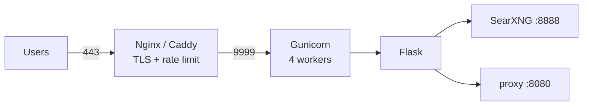

**Recommended production setup:**

- Terminate TLS with Nginx or Caddy and enable HTTP/2
- Set a strong `FLASK_SECRET_KEY`
- Rate-limit at the reverse proxy
- Keep worker count modest — the in-memory cache is per worker
- Monitor `/tmp/searxng.log` and `/tmp/proxy.log`, or run SearXNG separately and set `SEARXNG_URL`

### PythonAnywhere free plan

- Set `SEARXNG_DISABLE_LOCAL_START=1` and point `SEARXNG_URL` at an external instance.
- External calls go through the Cloudflare Worker relay (`PROXY_WORKER_URL`).
- Prefer MySQL/Postgres over SQLite (PythonAnywhere warns SQLite is slow on network filesystems).
- Keep workers low; the cache reduces repeated upstream calls.
- See `PYTHONANYWHERE_DEPLOYMENT.md` and `CLOUDFLARE_WORKER_SETUP.md`.

---

## Contributing

Contributions are welcome! Sodeom is open source under the GPLv3 license.

1. Fork the repository
2. Create your feature branch (`git checkout -b feature/amazing-feature`)
3. Run the smoke suite (`python -m unittest test_everything.SodeomSmokeTest`)
4. Commit your changes (`git commit -m 'Add amazing feature'`)
5. Push to the branch (`git push origin feature/amazing-feature`)
6. Open a Pull Request

### Areas for contribution

- Adding more search engine backends
- Improving result ranking and deduplication
- UI/UX and accessibility improvements
- Translation / i18n support
- Performance and cache tuning
- Documentation and self-hosting guides

---

## License

This project is licensed under the **GNU General Public License v3.0** — see the [LICENSE](LICENSE) file for details.

You are free to use, modify, and distribute this software under the terms of the GPLv3.

---

## Contact

- **Website:** <https://sodeom.com/>
- **Email:** [sodeom@sodeom.com](mailto:sodeom@sodeom.com)
- **Contact page:** <https://sodeom.com/contact>
- **GitHub:** <https://github.com/sodeom/sodeom>

---

<p align="center">
  Built with ❤️ by <strong>Abdul Hadi</strong><br/>
  © 2025–2026 Sodeom Search Engine
</p>
